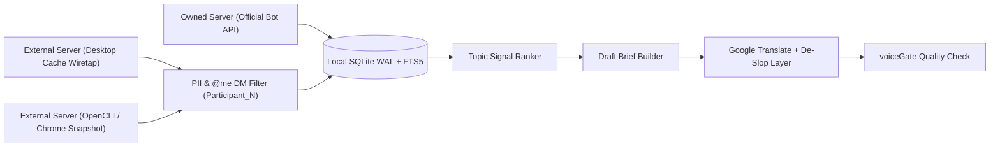

# Discord Radar

**Archive Discord channels into a local SQLite FTS5 vault, cluster recurring topics, strip AI filler, and translate drafts across languages cleanly.**

Discord Radar works for both servers you administer (via scoped official Bot tokens) and community servers you follow as a normal member (via zero network desktop cache extraction or read only browser snapshots). Every private `@me` direct message stays quarantined out of storage, external member handles are anonymized to `Participant_N`, and every draft passes through an anti slop and Google Translate pipeline before leaving your machine.



## 1. Safe Capture Modes

| Capture Mode | Server Role Needed | Network Activity | Default Privacy Safeguards |
| :--- | :--- | :--- | :--- |
| **Bot API (`bot_api`)** | `Manage Server` | Standard official Discord `Bot ` REST API | Rejects user `mfa.` selfbot tokens; limits attachment URLs to `https://` port `443` Discord CDN hosts. |
| **Desktop Wiretap (`desktop_wiretap`)** | Member only | **Zero** (reads local Discord Desktop cache via [`scripts/crawl-wiretap.sh`](./scripts/crawl-wiretap.sh)) | Drops `@me`, `dm`, and `direct_message` entries before insert; replaces handles and IDs with `Participant_N`. |
| **Browser Snapshot (`browser_snapshot`)** | Member only | Normal interactive Chrome tab viewing | Parses accessibility JSON, message arrays, or timestamps in [`src/snapshot.ts`](./src/snapshot.ts) without touching cookies or `localStorage`. |

## 2. Quick Start (`Bun >= 1.3`)

1. Install dependencies and copy the starter configuration files:

```zsh
bun install
cp .env.example .env
cp configs/demands.example.json configs/demands.local.json
cp configs/discrawl-external-wiretap.example.toml configs/discrawl-external-wiretap.local.toml
chmod 600 .env configs/demands.local.json configs/discrawl-external-wiretap.local.toml
bun run doctor --json
```

2. Edit `configs/demands.local.json` with your topic keywords, source guild or channel IDs, and target channels inside your own server. Every `*.local.*` file stays untracked in [`.gitignore`](./.gitignore).

3. Import external discussions passively from your local Discord Desktop cache (`Tier 2`):

```zsh
bash scripts/crawl-wiretap.sh configs/discrawl-external-wiretap.local.toml TARGET_EXTERNAL_GUILD_ID
```

4. Or import a browser tab snapshot captured via `OpenCLI` (`opencli browser state --source ax`) or Chrome DevTools MCP (`take_snapshot`):

```zsh
bun run ingest:snapshot \
  --file .state/channel-snapshot.json \
  --guild TARGET_EXTERNAL_GUILD_ID \
  --channel TARGET_EXTERNAL_CHANNEL_ID \
  --channel-name remotion-help \
  --json
```

5. Query archived discussions in milliseconds, cluster recurring topics, and build a verified draft brief:

```zsh
bun run today --hours 24 --json
bun run search "audio timeout" --json
bun run signals --demand ai-video-and-remotion --json
bun run brief --demand ai-video-and-remotion --target-channel "#video-tips" --json
```

## 3. Google Translate & Anti Slop Content Layer

Community discussions often contain mixed phrasing, and AI drafts frequently introduce cliché openers, em dashes, or broken spacing. Discord Radar pairs `checkVoiceGate` + `stripContentSlop` in [`src/security.ts`](./src/security.ts) with a token safe Google Translate wrapper in [`src/translate.ts`](./src/translate.ts):

1. **Protected Technical Tokens**: Before sending text to Google Translate, fenced code blocks, inline backticks (`` `bun run search` ``), `https://` URLs, and `#channel` tags are swapped with positional markers and restored verbatim after translation.
2. **Direct Content Brief Translation**: Pass `--lang <code>` (or set `RADAR_TARGET_LANG` in `.env`) on `brief` to translate the headline, numbered outline, and draft starter into your target audience's language and run `checkVoiceGate` automatically:

```zsh
bun run brief \
  --demand ai-video-and-remotion \
  --target-channel "#video-tips" \
  --lang vi \
  --json
```

3. **Standalone Text Translation & Pivot De-Slopping**: Run `bun run translate` directly on drafts or notes. Passing `--pivot <intermediate_lang>` (for example `--from en --to en --pivot vi`) runs a two hop round trip through Google Translate followed by `stripContentSlop` so stiff phrasing flattens out while technical tokens stay intact:

```zsh
bun run translate --text "Step by step fix for \`bun run search\` timeout in #video-tips" --to vi --json
bun run translate --text "Your draft text here" --from en --to en --pivot vi --json
```

4. **Cloud API Key Optional**: Unset `GOOGLE_TRANSLATE_API_KEY` uses the keyless `translate.googleapis.com` `gtx` endpoint by default; setting `GOOGLE_TRANSLATE_API_KEY` in `.env` upgrades requests cleanly to Google Cloud Translation v2.

## 4. Daily Content Tracing & Randomized Window Automation

Discord Radar tracks how community discussions change day over day without running at the same clock minute every morning:

1. **Snapshot Drop Folder (`.state/inbox/`)**: Drop `.json`, `.jsonl`, or `.txt` browser snapshots into `.state/inbox/` (optionally named `<guildId>__<channelId>__<channelName>.json` or matching a configured `channelName`). Every `digest` run ingests queued files, triggers passive local `discrawl` cache extraction when configured, and archives processed files under `.state/inbox/processed/`.
2. **Delta Signal Tracing (`digest`)**: `bun run digest` compares today's clusters against the newest prior `YYYY-MM-DD.json` report in `.state/digests/`, tagging every topic as `new`, `rising`, `steady`, or `cooling` with exact post count deltas and a `voiceGate` checked Markdown summary:

```zsh
bun run digest --lang vi --json
```

3. **Daily Randomized Execution Window (`schedule`)**: Instead of hitting the same fixed minute each day, `src/schedule.ts` picks one random minute per calendar day inside `--window-start` (`08:00`) through `--window-end` (`18:00`) in your local timezone. Polling every 5 minutes via cron checks `.state/schedule-state.json`, executes `digest` once when the random slot arrives, logs runs into `.state/schedule.log`, and records daily history in `.state/schedule-history.jsonl`:

```zsh
bun run schedule --preview-days 5 --window-start 08:00 --window-end 18:00 --json
bun run schedule --install-cron --window-start 08:00 --window-end 18:00 --tz Asia/Ho_Chi_Minh --json
```

## 5. CLI Command Reference (`schema_version: "1"`)

All commands support `--json` and emit `{ ok, schema_version, data | error }` automatically when stdout is non TTY:

| Command | Purpose | Key Flags |
| :--- | :--- | :--- |
| `doctor` | Verify DB path, `DISCORD_BOT_TOKEN` Bot prefix format, `discrawl` binary, and active demand config | `--db`, `--demands-file`, `--json` |
| `targets` | Display active topic profiles loaded from `configs/demands.local.json` or `configs/demands.example.json` | `--demands-file`, `--json` |
| `ingest-snapshot` | Parse browser JSON, accessibility trees, or timestamped logs into SQLite | `--file`, `--guild`, `--channel`, `--channel-name`, `--db` |
| `ingest-jsonl` | Import JSONL message streams from `discrawl` SQL queries or Bot exporters | `--file`, `--tier`, `--guild`, `--channel`, `--db` |
| `today` | List archived messages from the last `N` hours excluding quarantined `@me` DMs | `--hours`, `--guild`, `--channel`, `--limit`, `--db` |
| `search` | Run BM25 ranked SQLite FTS5 full text search across stored discussions | `<query>`, `--guild`, `--channel`, `--limit`, `--db` |
| `signals` | Cluster questions, recurring bugs, feature requests, and comparisons by keyword score | `--demand`, `--keywords`, `--hours`, `--demands-file` |
| `brief` | Generate a headline, outline, and `voiceGate` checked draft starter with optional `--lang` / `--pivot` translation | `--demand`, `--target-channel`, `--lang`, `--pivot`, `--from` |
| `digest` | Ingest `.state/inbox/` + configured wiretap, trace day over day topic deltas, and write `.state/digests/YYYY-MM-DD.{md,json}` | `--hours`, `--inbox-dir`, `--out-dir`, `--lang`, `--pivot` |
| `schedule` | Pick one random daily run minute inside `08:00` to `18:00`, inspect upcoming slots, run ticks, or install crontab | `--install-cron`, `--preview-days`, `--tick`, `--window-start`, `--window-end`, `--tz` |
| `translate` | Translate or back translate drafts with protected code/links/channels plus `stripContentSlop` and `checkVoiceGate` | `--text`, `--file`, `--to`, `--from`, `--pivot` |
| `voice-check` | Validate drafts against AI filler phrases, zero width Unicode, HTML tags, dash slop, and verbatim overlap | `--draft`, `--file` |

## 6. Development, PRDs & Privacy Hygiene

1. **Automated Tests & Typecheck**:

```zsh
bun test
bunx tsc --noEmit
```

2. **Local Storage Isolation**: `.env`, `.state/`, `configs/*.local.json`, `configs/*.local.toml`, and `*.db` files are gitignored; local directories are created at `0700` and SQLite databases at `0600`.
3. **Architecture PRDs & Backlog**: Read [`docs/requirements/README.md`](./docs/requirements/README.md) and [`docs/epics/EPICS_AND_ROADMAP.md`](./docs/epics/EPICS_AND_ROADMAP.md).
4. **Sync Backlog to Your GitHub Repository**: Preview planned labels, milestones, and issues via `node scripts/sync-github-epics.mjs --dry-run` before pushing updates to your own repository.
